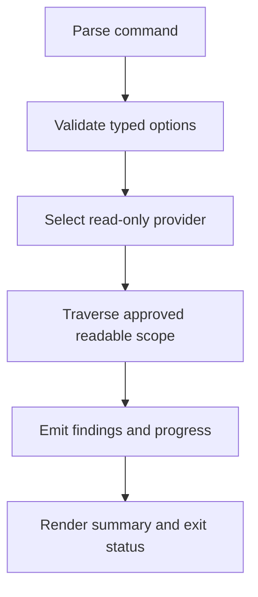
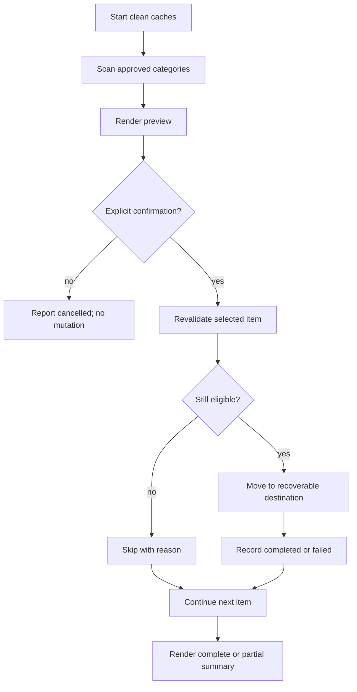

# Technical Design MHK-001 — MacHousekeeper MVP — Technical Design Document

| | |
|---|---|
| **Status** | Approved v1.0, lead architect, 2026-10-16 |
| **Design source** | No separate approach document; placement is obvious for a new local terminal executable. Expands [docs/PRD.md](../PRD.md) v0.2. |
| **base_commit** | No commit yet; initial uncommitted repository state. |
| **Audience** | technical lead, implementer, reviewer, product owner, lead architect |
| **Date** | 2026-10-16 |

## Document control

| Item | Value |
|---|---|
| Feature | MacHousekeeper MVP |
| Owns | CLI commands, scan and cleanup behaviour, local data contracts, safety rules, configuration, testing, and operational behaviour |
| Does not own | Product scope decisions in the PRD, future GUI, application removal, persistence, network services, or telemetry |
| Source requirements | [docs/PRD.md](../PRD.md) v0.2, especially sections D, E, and F |
| Companion artifacts | Future implementation plan under `docs/implementation-plan/`; no approach document |

### Revision log

| Version | Date | Change |
|---|---|---|
| v0.1 | 2026-10-16 | Initial MVP technical design for local scanning, safe cleanup, application inventory, and memory status. |
| v1.0 | 2026-10-16 | Approved by the lead architect for implementation planning. |

**Change markers.** Sections changed in this version are marked inline:
<mark>NEW v0.1</mark> added this version.

### Deviations from steering files

| # | Rule | File | Deviation | Why the compliant path does not work | Cost carried | Status |
|---|---|---|---|---|---|---|
| | none | | | | | |

**Approval record**

| Who | When | What exactly was approved |
|---|---|---|
| Lead architect | 2026-10-15 | Initial workspace Git setup and adaptation of project steering files. |
| Lead architect | 2026-10-16 | Technical design v1.0 and implementation planning for the approved MVP requirements. |

## 1. Overview

MacHousekeeper is a local Swift command-line executable for selected macOS locations. It reports large files, eligible cleanup findings, installed applications, and memory status. Scanning performs no mutation. Cleanup is interactive, revalidates each selected item, and uses recoverable removal where macOS permits it.

The MVP deliberately has no database, daemon, GUI, network client, telemetry, arbitrary shell execution, or application uninstall operation.

## 2. Current state — verified

| # | Fact | Evidence | Verified / Inferred |
|---|---|---|---|
| V1 | The repository currently contains the PRD and steering files but no application source. | `docs/PRD.md:8`, `AI.md:37-40` | verified |
| V2 | The target is a local macOS terminal executable running as a normal user. | `docs/PRD.md:69-76` | verified |
| V3 | The MVP is offline and has no persistent store or remote API. | `docs/PRD.md:59-67`, `docs/PRD.md:295` | verified |
| V4 | Cleanup must be allowlisted, confirmed, recoverable where possible, and resilient to item-level failure. | `.ai-mac-housekeeper-steering/security.md:5-14` | verified |
| V5 | The source requirement set contains sixteen functional rows, one of which is withdrawn from this scan-only MVP, and six non-functional rows. | `docs/PRD.md:94-111`, `docs/PRD.md:288-297` | verified |

**Constraints this imposes**

- The first implementation must be a small Swift Package Manager executable under `Sources/MacHousekeeper/`.
- Any cleanup operation must be safe when interrupted, denied, or raced by another process.
- The design cannot rely on persisted scan state because no persistence is in scope.

**Live exposures found while designing**

- The PRD is approved. No implementation should be treated as production-ready until the implementation tests and manual verification pass.

## 3. Requirements and coverage

### 3.1 Functional

| REQ ID | Satisfied by § | Test | State | Notes |
|---|---|---|---|---|
| REQ-MHK-001-01 | §4.1, §4.3 | `LargeFileScanTests.reportsThresholdMatchesWithMetadata` | met | |
| REQ-MHK-001-02 | §4.1, §4.2 | `CleanupScanTests.reportsEligibleItemsByCategory` | met | |
| REQ-MHK-001-03 | §4.1, §4.4 | `ApplicationScanTests.reportsApplicationInventory` | met | |
| REQ-MHK-001-04 | §4.4 | `ApplicationScanTests.doesNotClassifyMissingEvidenceAsUnused` | met | |
| REQ-MHK-001-05 | §4.1, §4.5 | `MemoryStatusTests.reportsTimestampedMemoryStatus` | met | |
| REQ-MHK-001-06 | §4.3 | `ScanSummaryTests.reportsCountsAndSizes` | met | |
| REQ-MHK-001-07 | §4.2, §4.3 | `CleanupConfirmationTests.previewsSelectionBeforeMutation` | met | |
| REQ-MHK-001-08 | §4.2 | `CleanupExecutionTests.removesOnlyConfirmedEligibleItems` | met | |
| REQ-MHK-001-09 | §4.2, §5 | `CleanupExecutionTests.reportsPerItemOutcomesAndActualSize` | met | |
| REQ-MHK-001-10 | §4.2 | `CleanupSafetyTests.doesNotMutateWithoutConfirmation` | met | |
| REQ-MHK-001-11 | §4.2, §5 | `CleanupSafetyTests.continuesAfterItemLevelFailure` | met | |
| REQ-MHK-001-12 | §4.2, §5 | `CleanupSafetyTests.reportsPartialCompletionAccurately` | met | |
| REQ-MHK-001-13 | — | — | withdrawn | Application removal is outside the scan-only MVP. |
| REQ-MHK-001-14 | §4.1, §5 | `PermissionHandlingTests.continuesAfterDeniedLocation` | met | |
| REQ-MHK-001-15 | §4.1, §4.4, §4.5, §5 | `ScanIntegrityTests.reportsUnknownInformationWithoutFabrication` | met | |
| REQ-MHK-001-16 | §4.2 | `CleanupSafetyTests.rejectsItemsOutsideApprovedCategories` | met | |

### 3.2 Non-functional

| REQ ID | Property | Measure | Enforced at § | Test |
|---|---|---|---|---|
| REQ-MHK-001-NF01 | No cleanup mutation without explicit confirmation. | Filesystem fixture remains unchanged when confirmation is absent or negative. | §4.2 | `CleanupSafetyTests.doesNotMutateWithoutConfirmation` |
| REQ-MHK-001-NF02 | Normal-user execution. | Commands run successfully without root privileges for accessible paths. | §4.1, §4.2 | `PrivilegeTests.runsWithoutRoot` |
| REQ-MHK-001-NF03 | Item-level outcome preservation. | Every selected item has one terminal outcome. | §4.2, §5 | `CleanupSafetyTests.reportsAllItemOutcomes` |
| REQ-MHK-001-NF04 | Offline privacy. | No network process or socket is opened during command execution. | §4.1, §8 | `OfflineOperationTests.opensNoNetworkConnection` |
| REQ-MHK-001-NF05 | Command-level exit status. | Invalid input and unavailable command failures return non-zero status. | §4.3, §5 | `CLIIntegrationTests.returnsFailureStatus` |
| REQ-MHK-001-NF06 | Long-scan progress. | A scan exceeding two seconds emits status or progress output. | §4.1, §4.3 | `ProgressTests.emitsProgressForLongScan` |

**Untraceable sections:** none · **Uncited requirements:** none

### 3.3 Amendments

REQ-MHK-001-13 was withdrawn in PRD v0.2 because the MVP is scan-only for applications. The identifier remains reserved and is not implemented by this design.

## 4. Detailed design

### 4.1 Service and component architecture

The executable is a single local process with small components and no persistence:

| Component | Responsibility | Dependencies | Ordering and concurrency |
|---|---|---|---|
| CLI command layer | Parses commands and typed options, validates bounds, coordinates one operation, and maps outcomes to exit status. | Swift standard library, Foundation. | One command per process; no shared mutable state. |
| Scan coordinator | Selects the requested provider, emits progress, aggregates findings, and produces a summary. | Scan providers and renderer. | Read-only traversal; providers may be sequential in the MVP. |
| Large-file provider | Traverses user-selected readable roots without following symlinks and reports files meeting the threshold. | Foundation `FileManager`. | Stable result ordering by descending size, then path. |
| Cache provider | Enumerates only code-owned, reviewed regenerable cache categories and marks unknown locations scan-only. | Foundation `FileManager`, cleanup policy. | No mutation during scan. |
| Application provider | Finds applications in `/Applications` and `~/Applications`, reads bundle metadata, computes installed size, and obtains optional usage evidence. | Foundation, AppKit, optional `mdls` subprocess. | Missing evidence is an explicit state, never a positive unused classification. |
| Memory provider | Reads physical-memory information and supported memory/swap indicators with a timestamp. | Foundation `ProcessInfo`, controlled `Process` calls. | One point-in-time observation; unavailable indicators are reported. |
| Cleanup policy | Checks category, approved root, path type, symlink status, and user selection before mutation. | Foundation URL and resource-value APIs. | Revalidated serially immediately before each mutation. |
| Cleanup executor | Applies confirmed cleanup, prefers recoverable removal, and records per-item outcome. | Foundation file operations. | Serial mutation; one item failure does not abort the batch. |
| Text renderer | Produces human-readable tables, summaries, progress, warnings, and errors. | Swift standard library. | No persistent output and no machine-readable contract in MVP. |

The CLI layer is the only entry point. No component invokes a shell through a string; subprocesses receive an executable URL and separate argument values. No network framework is included.

### 4.2 Database schema

Not applicable. The MVP has no database, preferences store, scan cache, or remote state. Findings exist only for the duration of a command. User-selected cleanup is confirmed and executed within the same process; a future persisted selection workflow would require a new design.

### 4.3 API contracts

The external API is the terminal command surface.

| Command | Inputs | Output | Mutation | Failure status |
|---|---|---|---|---|
| `mac-housekeeper scan large-files [--root PATH] [--min-size BYTES]` | Optional user path and positive size threshold. Root is read-only and must be readable. | Finding rows with path, logical size, modification date, and summary. | None. | Non-zero for invalid options; partial result with warnings for denied entries. |
| `mac-housekeeper scan caches` | No arbitrary cleanup path input. | Eligible and scan-only cache findings grouped by category, with estimated size. | None. | Non-zero only when the command cannot produce a usable scan; item-level failures are reported. |
| `mac-housekeeper scan apps` | No path input in MVP. | Application name, bundle location, installed size, usage evidence, and evidence state. | None. | Non-zero only when application locations cannot be inspected at all. |
| `mac-housekeeper memory` | No input. | Timestamped memory and swap indicators plus non-destructive advice. | None. | Non-zero only when no supported status can be obtained. |
| `mac-housekeeper clean caches` | User selects findings from the displayed preview and confirms explicitly. | Preview, per-item outcome, logical size moved to Trash, and summary. | Only selected eligible items. | Non-zero for command failure; partial item failure is reported and does not erase other outcomes. |

The internal finding shape is:

```text
Finding {
  id: stable-in-command identifier
  category: large-file | cache | application
  path: absolute URL
  size: logical or estimated byte count
  modificationDate: optional timestamp
  eligibility: read-only | eligible | rejected
  evidence: optional human-readable evidence
  reason: optional limitation or rejection reason
}
```

The internal cleanup outcome shape is:

```text
CleanupOutcome {
  findingID: command-local identifier
  result: completed | skipped | failed
  reclaimedBytes: zero or logical bytes moved to Trash
  reason: optional user-visible explanation
}
```

### 4.4 Process, workflow or rule design

#### Read-only scan flow



#### Cleanup flow



The cleanup policy is the backstop: a finding identifier is not trusted by itself. Before mutation, the executor resolves the current path and confirms containment under an approved root. It rejects symlinks and directories outside the category policy. It also confirms that the item still matches the previewed eligibility. If any check fails, the item is skipped.

### 4.5 Configuration

| Key | Default | Level | Runtime-changeable | Effect |
|---|---|---|---|---|
| `minLargeFileBytes` | Product-documented default chosen during implementation | CLI option | Yes, per invocation | Controls the large-file finding threshold. |
| `progressIntervalSeconds` | 2 | Internal constant | No | Controls progress output for long scans. |
| `approvedCleanupCategories` | Code-owned reviewed set | Code policy | No | Determines which findings can be mutated. |
| `applicationScanRoots` | `/Applications`, `~/Applications` | Code policy | No | Determines application inventory scope. |

No configuration file, environment secret, network endpoint, or user-editable cleanup policy is introduced in the MVP.

### 4.6 Identity, tenancy and authorization

There is no account identity or tenancy model. Authorization is the local user’s filesystem permission plus the cleanup policy. The CLI never requests root privileges, and the cleanup executor rejects paths outside approved categories even when the operating system permits access.

## 5. Error handling

| # | Failure | Behaviour | Caller sees | Open / closed |
|---|---|---|---|---|
| F1 | Invalid command or option | Reject before scanning or mutation. | Usage message and non-zero exit status. | closed |
| F2 | Invalid or unsafe path | Reject the path as a scan root or cleanup target. | Safe validation error without command execution. | closed |
| F3 | Permission denied during scan | Record the location and continue independent traversal. | Warning, partial scan summary, and successful command status when useful results exist. | closed |
| F4 | Missing or changed item after preview | Revalidate and skip the item. | Per-item skipped result with reason. | closed |
| F5 | Cleanup operation fails | Record failure and continue the batch. | Per-item failed result and partial summary. | closed |
| F6 | Recoverable removal unavailable | Do not fall back to permanent deletion. | Item failed with recovery-unavailable reason. | closed |
| F7 | External metadata command unavailable | Mark usage or memory indicator unavailable; do not fabricate it. | Explicit limitation in output. | closed |
| F8 | Scan source returns malformed or incomplete data | Reject the affected datum and retain unknown state. | Limitation warning; no invented finding. | closed |
| F9 | User cancels confirmation | End without mutation. | Cancelled summary and zero logical bytes moved to Trash. | closed |

## 6. Testing strategy

| Level | What it proves | Where it lives |
|---|---|---|
| unit | Threshold parsing, path containment, eligibility policy, result aggregation, output formatting, and failure classification. | `Tests/MacHousekeeperTests/` |
| integration | Real temporary-directory scans, permission-denied fixtures where supported, subprocess parsing, CLI exit status, and cleanup preview. | `Tests/MacHousekeeperTests/` |
| negative-authorization | Cleanup rejects an unapproved path, a symlink, an unconfirmed selection, and a changed item. | `Tests/MacHousekeeperTests/CleanupSafetyTests.swift` |
| performance | Progress output begins for a controlled fixture exceeding two seconds; scan results remain bounded to requested scope. | `Tests/MacHousekeeperTests/ProgressTests.swift` |
| manual macOS verification | Application metadata and memory indicators are checked on a supported Mac without mutating real user data. | Release checklist under `docs/` |

Tests must use temporary fixtures and injected providers for destructive paths. They must not clean a developer’s real cache or application directories.

## 7. Rollout and rollback

| Step | What deploys | Backward-compatible? | How it is undone | What cannot be undone once data is written |
|---|---|---|---|---|
| 1 | Unsigned local Swift executable for development | yes | Remove the built executable. | None; development tests use temporary fixtures. |
| 2 | MVP executable distributed locally | yes | Replace or remove the executable. | A user action may move an item to Trash; recovery depends on Trash availability and user actions. |

**Data migration path** — None. The MVP has no persistent data.

## 8. Monitoring and observability

The CLI reports command name, counts, sizes, duration, warnings, and per-item outcomes to the terminal. It does not persist logs or send telemetry. It must not print file contents, secrets, uncontrolled stack traces, or shell command strings. Each command run gets a process-local operation identifier only when needed to correlate progress and final output; the identifier is not persisted.

## 9. Dependencies

| Depends on | Kind | Status | Blocking? |
|---|---|---|---|
| Swift 6.x toolchain and Swift Package Manager | build/runtime | available on target development environment | yes |
| Foundation | Apple platform framework | available on macOS | yes |
| AppKit | Apple platform framework | available on macOS | only for application inventory |
| `mdls`, `vm_stat`, and `sysctl` | optional macOS executables | must be checked at runtime | no; affected indicators become unavailable |

## 10. Troubleshooting

| Symptom | Likely cause | Where to look | Failure | Fix |
|---|---|---|---|---|
| A location is missing from results | macOS denied access or the path does not exist. | Warning lines in the command output. | F3 | Run against an accessible user-owned location; do not request root in MVP. |
| A selected item is not cleaned | It changed, is outside policy, or is no longer eligible. | Per-item skipped reason. | F4 | Re-run the scan and select the current eligible finding. |
| Cleanup reports partial completion | One or more independent items failed. | Per-item outcome table. | F5 | Review failed items; successful outcomes remain reported. |
| Application usage shows unknown | Spotlight metadata is unavailable or ambiguous. | Application evidence column. | F7/F8 | Treat the application as a candidate requiring user review, not as unused. |
| Memory output is incomplete | A macOS indicator or command is unavailable. | Memory command limitation warning. | F7 | Use the available indicators; do not infer missing values. |
| No files are removed after running clean | Confirmation was cancelled or rejected. | Cleanup summary. | F9 | Re-run and explicitly confirm the preview. |

## 11. Decisions

| # | Decision | Date | Decided by | Rationale — the fact that forces it | Alternative rejected |
|---|---|---|---|---|---|
| D1 | Use Swift with Swift Package Manager for the macOS-only CLI. | 2026-10-16 | Lead architect, design recommendation | Native access to Foundation and AppKit with a small executable footprint. | Rust or Go would add platform-integration complexity for this macOS-only MVP. |
| D2 | Use one local process with no persistence. | 2026-10-16 | Lead architect, design recommendation | MVP operations are point-in-time scans and immediate cleanup; persistence adds data-retention and stale-selection risk. | Database or scan cache deferred until a workflow requires it. |
| D3 | Keep scan and cleanup as separate command paths. | 2026-10-16 | Lead architect, design recommendation | Read-only inspection must be safe to run repeatedly; mutation needs a distinct confirmation boundary. | One-click scan-and-clean rejected because it weakens user review. |
| D4 | Use recoverable removal and never fall back to permanent deletion. | 2026-10-16 | Lead architect, design recommendation | The product must provide a recovery path where macOS permits it and protect against irreversible mistakes. | Direct unlink/permanent deletion rejected for MVP. |
| D5 | Inventory applications but do not remove them in the MVP. | 2026-10-16 | Lead architect, scope decision | The PRD defines scan-only application discovery and excludes uninstallation. | Automatic or semi-automatic uninstall deferred to a separately approved requirement. |
| D6 | Treat missing application or memory evidence as unknown. | 2026-10-16 | Lead architect, design recommendation | The product must not fabricate classifications or promise a RAM refresh. | Guessing from modification date or one incomplete metric rejected. |

## 12. Open questions and assumptions

| # | Question | Blocking? | Recommended answer | Answered by, date |
|---|---|---|---|---|
| QD1 | What exact reviewed cache path set ships in the first implementation? | no | Start with a code-owned allowlist of user-owned, regenerable categories; unknown locations remain scan-only. | Project assumption, 2026-10-16 |
| QD2 | What product default should be used for the large-file threshold? | no | Choose a documented default during implementation and allow an explicit per-invocation threshold. | Project assumption, 2026-10-16 |

**Assumption:** The project owner asked that unresolved questions use the documented assumptions. These answers remain revisable through the PRD/design revision process.

## 13. Review record

**Reviewers:** Codex self-review and lead architect · **Date:** 2026-10-16 · **Method:** Stage 3 checklist and explicit approval

| # | Finding | Severity | Disposition | Where it landed |
|---|---|---|---|---|
| R1 | Application removal conflicted with the scan-only MVP scope. | high | Resolved by withdrawing REQ-MHK-001-13 in PRD v0.2. | `docs/PRD.md:23`, `docs/PRD.md:108` |
| R2 | Broad cache deletion would risk browser and developer data. | high | Resolved by requiring a code-owned reviewed allowlist and scan-only treatment for unknown locations. | §4.2, §5 F2, project security rules |
| R3 | No implementation exists yet, so runtime measurements are not available. | medium | Carried as a verification obligation for the implementation plan. | §6, §12 |
| R4 | Design is consistent with the approved PRD and project steering rules. | info | Accepted; proceed to implementation planning. | §§3-8 |

**Consequences of rejected findings**

None. No finding was rejected.

**Declared gaps and compliance residuals**

The exact initial cache-path allowlist and performance baseline still need implementation-time verification, but neither permits broad deletion or unmeasured claims.

## 14. System map cards to update

None affected. No system-map cards exist yet because the repository contains no implementation.

## 15. Steering files applied

- `.ai-steering/governance.md`
- `.ai-steering/architecture-principles.md`
- `.ai-steering/security.md`
- `.ai-steering/workflows/design-document.md`
- `.ai-mac-housekeeper-steering/stack.md`
- `.ai-mac-housekeeper-steering/security.md`
- `.ai-mac-housekeeper-steering/workflows/design-document.md`

